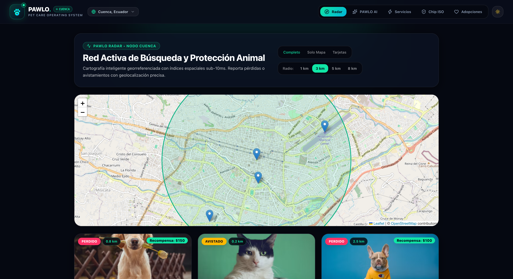
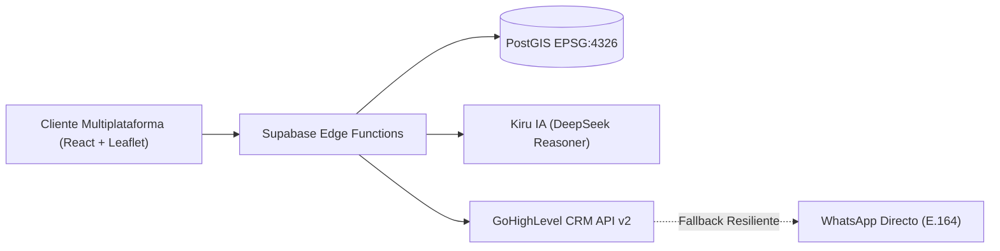

<div align="center">

# 🐾 KIRUPET™
### Todo para tu Mascota en 1 Toque — Cuidado Fácil & Bóveda Mascota
**Red Tecnológica Descentralizada para Bienestar Animal, Radar Geoespacial y Comercio Direct-to-Care**

[](https://www.typescriptlang.org/)
[](https://react.dev/)
[](https://tailwindcss.com/)
[](https://postgis.net/)
[](https://deepseek.com/)
[](LICENSE)

<br />



</div>

---

## 🌟 ¿Qué es KIRUPET™?

**KIRUPET™** es una plataforma integral creada para transformar el cuidado animal en entornos urbanos. Construida con una **arquitectura por Nodos Urbanos**, KIRUPET puede desplegarse en cualquier ciudad del mundo preservando la cartografía local, medios de pago autóctonos y redes privadas de profesionales.

El primer nodo operativo de la red es **Cuenca (Ecuador)**, con soporte para expansión a ciudades como Quito, Guayaquil, Bogotá y Lima.

---

## 🚀 Módulos Principales (Super-App v2.0)

### 0. 🐾 Mis Mascotas — Bóveda Biométrica & Expediente Clínico Individual
* **Fichas Completas por Mascota**: Gestión ilimitada de perros y gatos del usuario con foto, raza, edad exacta, control de peso (kg), alergias, ración diaria (g) y código de Microchip ISO.
* **Carnet Digital de Vacunación y Desparasitación**: Registro con número de lote, fecha de aplicación, fecha de próximo refuerzo, clínica y médico veterinario tratante.
* **Historia Clínica Centralizada**: Consultas generales, profilaxis dental, laboratorios, cirugías, temperatura y evolución de peso.
* **Álbum Fotográfico & Bitácora de Notas**: Galería de fotos de cada mascota y diario personal de dieta, medicación, conducta y recordatorios.

### 1. 🛍️ Tienda & Farmacia Veterinaria Personalizada
* **Catálogo Inteligente Filtrado por tu Mascota**: Comida super premium, Medicamentos y Antiparasitarios (con validación de carnet/receta electrónica), Juguetes de enriquecimiento, Camas ortopédicas viscoelásticas y Casas térmicas/Kennels IATA.
* **Carrito & Checkout Directo**: Integración inmediata con WhatsApp y medios de pago locales (*Deuna P2P*, *Pichincha*, *Produbanco*, *Tarjeta*).

### 2. ⚡ Servicios Integrales Direct-to-Care
* **5 Verticales Especializadas**:
  - 🚕 **Transporte Pet Taxi**: Vehículos climatizados con anclaje ISOFIX y GPS en vivo.
  - 🏨 **Hospedaje & Guardería**: Suites libres de jaulas con cámaras 24/7.
  - ✂️ **Grooming & Spa Móvil**: Ozonoterapia dermocosmética en la puerta de tu casa.
  - 🩺 **Veterinaria & Especialidades 24/7**: Sincronizada con el Carnet Digital KIRUPET.
  - 🧠 **Etología & Paseo Educativo**: Rehabilitación conductual certificada.

### 3. 📱 Preparado para Apple App Store (iOS) & Google Play Store (Android)
* **Ionic Capacitor 7 (`com.kirupet.app`)**: Configuración nativa lista en [`capacitor.config.ts`](capacitor.config.ts), manifiesto PWA ([`public/manifest.webmanifest`](public/manifest.webmanifest)), soporte `viewport-fit=cover` y barra de navegación inferior nativa para móviles.
* Consulta la guía paso a paso en [`docs/APP_STORE_DEPLOYMENT.md`](docs/APP_STORE_DEPLOYMENT.md).

### 4. 🗺️ Radar Geoespacial en Vivo & Adopciones Comunitarias
* **Motor Espacial**: Basado en **PostgreSQL 15 + PostGIS (EPSG:4326)** con índices `GiST` y consultas `ST_DWithin` para proteger también a todos los animales de la ciudad.
* **Latencia Ultra-Baja**: Respuestas sub-10ms (benchmark verificado de **0.172 ms** en 5,000 registros).
* **Filtros Dinámicos**: Escaneo por radio (1 km a 8 km) con círculos de cobertura WGS84 reactivos en **Leaflet**.

### 5. 🧠 Asistente de Triaje Inteligente (Kiru IA / KiruPet IA)
* **Modelos**: Integración con **DeepSeek-V3** y **DeepSeek-R1 Reasoner**.
* **Blindaje Farmacológico Absoluto**: Cortafuegos determinista que bloquea al 100% intentos de prescripción o dosificación casera.
* **Escala de Triaje RGB**:
  - 🔴 **ROJO (0h)**: Emergencias vitales críticas (atropellos, convulsiones, hemorragias).
  - 🟡 **AMARILLO (<12h)**: Urgencias clínicas prioritarias.
  - 🟢 **VERDE**: Orientación etológica, bienestar y enriquecimiento ambiental.

### 6. ⚡ Comercio Conversacional Direct-to-Care
* **Conexión Directa**: Enlaces universales de WhatsApp (`wa.me`) con formato internacional E.164.
* **Integración CRM**: Sincronización automática de contactos y oportunidades en **GoHighLevel (GHL) API v2**.
* **Arquitectura Resiliente (Outbox Pattern)**: Si el CRM externo sufre caídas de red, la experiencia del usuario continúa sin fricción hacia WhatsApp.
* **Pasarelas Locales**: Soporte nativo para *Deuna (P2P)*, *Banco Pichincha*, *Produbanco* y transferencias directas.

### 7. 🛡️ Escáner de Microchips ISO Universal
* Validación algorítmica conforme a la norma internacional **ISO 11784/11785** (15 dígitos).
* Soporte para identificadores clínicos alfanuméricos privados.

### 8. 🎨 Sistema de Diseño Neo-Glass 2026 & Dual Theme
* **Dark Mode & Light Mode**: Selector de tema instantáneo con tokens CSS adaptativos.
* Creado y registrado mediante **Stitch MCP**.

---

## 📐 Arquitectura de Alto Nivel



---

## 🛠️ Pila Tecnológica

| Componente | Tecnología |
| :--- | :--- |
| **Frontend** | React 19, TypeScript, Vite, Tailwind CSS v4, Lucide Icons |
| **Mapas GIS** | Leaflet 1.9, React-Leaflet, OpenStreetMap Tiles |
| **Base de Datos** | PostgreSQL 15, PostGIS (EPSG:4326), Row Level Security (RLS) |
| **Backend Serverless**| Supabase Edge Functions (Deno / TypeScript) |
| **Inteligencia Artificial**| Kiru IA / DeepSeek API (V3 / R1 Reasoner) con Cortafuegos Farmacológico |
| **CRM / Comercio** | GoHighLevel REST API v2 + WhatsApp Universal Links |

---

## 📦 Instalación y Ejecución Local

### Prerrequisitos
* **Node.js** >= 20.x
* **npm** >= 10.x
* Cuenta de Supabase (opcional para desarrollo local con mocks)

### Pasos

1. **Clonar el repositorio**:
   ```bash
   git clone https://github.com/nicolasnorton/kirupet-app.git
   cd kirupet-app
   ```

2. **Instalar dependencias**:
   ```bash
   npm install
   ```

3. **Iniciar el servidor de desarrollo**:
   ```bash
   npm run dev
   ```
   Abre [http://localhost:5173](http://localhost:5173) en tu navegador.

4. **Ejecutar la suite de pruebas de blindaje y rendimiento**:
   ```bash
   python3 tests/run_validation_suite.py
   ```

---

## 📚 Documentación Técnica

* 📄 [Documento de Requisitos de Producto (PRD)](./docs/PRD.md)
* 🤖 [Guía de Contexto para Modelos y Agentes (llms.txt)](./llms.txt)
* 🏗️ [Diseño de Sistema y Flujos de Resiliencia](./docs/architecture/SYSTEM_DESIGN.md)
* 📱 [Guía de Publicación Móvil App Store & Play Store](./docs/APP_STORE_DEPLOYMENT.md)
* 🌐 [WebMCP & Comercio Agéntico](./docs/WEBMCP_AGENTIC_COMMERCE.md)

---

## 📄 Licencia

Este proyecto está licenciado bajo los términos de la Licencia MIT. Consulta el archivo [LICENSE](LICENSE) para más detalles.
