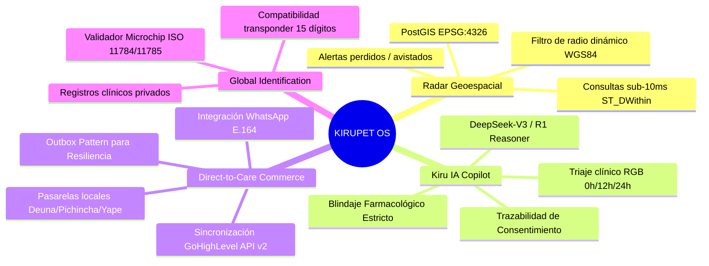

# PRD — KIRUPET™ (Todo para tu Mascota en 1 Toque)
**Documento de Requisitos de Producto (PRD) v2.6**  
**Estado:** Producción / Escalable Global  
**Identificador Móvil:** `com.kirupet.app`  
**Arquitectura:** Multi-Tenant por Nodos Urbanos (City Nodes)  

---

## 1. Visión & Propósito

**KIRUPET™** es una plataforma tecnológica directa y descentralizada de bienestar animal, tele-orientación clínica y comercio conversacional para mascotas. Diseñada con un modelo de **Nodos Urbanos** que permite desplegar la plataforma en cualquier ciudad del mundo preservando la cartografía local, pasarelas de pago autóctonas y redes independientes de clínicas y tutores.

El primer nodo operativo de la red es **Cuenca, Ecuador**, con arquitectura lista para expansión hacia Quito, Guayaquil, Bogotá y Lima.

---

## 2. Pilares de Producto

---

## 3. Personas y Casos de Uso

| Persona | Necesidad Crítica | Solución KIRUPET |
| :--- | :--- | :--- |
| **Tutor Urbano** | Su mascota se extravió en un parque concurrido. | Publicación georreferenciada inmediata en el Radar con radio de difusión en metros y recompensa visible. |
| **Tutor en Emergencia** | Su mascota ingirió una sustancia sospechosa a medianoche. | Consulta a Kiru IA con triaje ROJO determinista y derivación inmediata a hospitales 24h locales. |
| **Clínica / Proveedor** | Recibir solicitudes de servicios sin intermediación de comisiones abusivas. | Generación de oportunidades comerciales conectadas directamente a WhatsApp corporativo con contexto del paciente. |
| **Rescatista Independiente**| Encontrar familias idóneas para animales rescatados en hogares temporales. | Módulo de adopción directa ciudadana sin trabas burocráticas estatales. |

---

## 4. Requisitos Funcionales por Módulo

### 4.1. Módulo 1: Radar Geoespacial
- **RF-1.1**: Renderizado cartográfico interactivo mediante OpenStreetMap / Leaflet centrado en las coordenadas geodésicas del nodo urbano activo (ej. `-2.8974, -79.0045` en Cuenca).
- **RF-1.2**: Filtro de radio geodésico dinámico (1 km, 3 km, 5 km, 8 km) con representación visual del área de cobertura en tiempo real.
- **RF-1.3**: Marcadores reactivos con popups informativos (especie, estado, descripción y teléfono de contacto directo).
- **RF-1.4**: Vistas configurables: **Completo** (mapa + tarjetas), **Solo Mapa** o **Tarjetas**.

### 4.2. Módulo 2: Kiru IA & Blindaje Clínico
- **RF-2.1**: Aceptación obligatoria del consentimiento informado (*Clickwrap*) antes de habilitar el campo de entrada.
- **RF-2.2**: **Cortafuegos Farmacológico Determinista**: Bloqueo absoluto ante consultas sobre dosificación (`mg/kg`, `gotas`, `pastillas`), medicamentos humanos (ibuprofeno, paracetamol, aspirina) y fármacos veterinarios (ivermectina, meloxicam, tramadol).
- **RF-2.3**: Clasificación por niveles de triaje:
  - **ROJO (0h)**: Emergencias con riesgo vital inminente (atropello, convulsión, torsión gástrica).
  - **AMARILLO (<12h)**: Cuadros que requieren consulta prioritaria (vómitos, letargo).
  - **VERDE**: Guía etológica, paseos y refuerzo positivo.

### 4.3. Módulo 3: Comercio Direct-to-Care
- **RF-3.1**: Catálogo de servicios veterinarios, estética canina y etología adaptado a la moneda del nodo urbano.
- **RF-3.2**: Formulario de captura de lead con selección de medio de pago local (*Deuna P2P*, *Pichincha*, *Produbanco*, *Efectivo*).
- **RF-3.3**: Generación automática de enlace universal `https://wa.me/` con número E.164 preconfigurado y mensaje comercial con ID de referencia único (`KIRU-[CITY]-[REF]`).
- **RF-3.4**: Resiliencia: si el CRM externo falla, la redirección a WhatsApp se ejecuta sin interrupción.

### 4.4. Módulo 4: Validador de Microchips ISO Universal
- **RF-4.1**: Validación algorítmica del estándar internacional **ISO 11784/11785** (15 dígitos numéricos).
- **RF-4.2**: Soporte para identificadores clínicos alfanuméricos privados.

---

## 5. Requisitos No Funcionales (SLA & Seguridad)

- **Latencia de consultas espaciales**: `< 10 ms` (Verificado en benchmark: **0.172 ms** con índices GiST).
- **Disponibilidad**: Arquitectura serverless en Supabase Edge Functions con degradación elegante.
- **Rendimiento Frontend**: First Contentful Paint < 1.0s, peso de bundle comprimido < 130 kB gzip.
- **Accesibilidad**: Cumplimiento WCAG 2.1 AA (etiquetas semánticas, contraste y soporte para lectores de pantalla).
