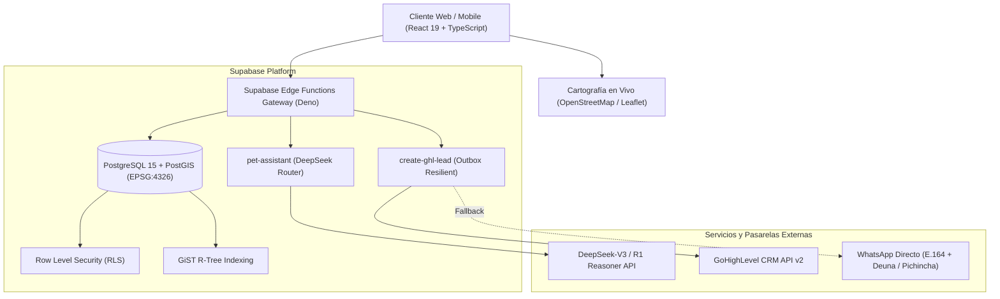

# Arquitectura Técnica — PAWLO™

Este documento describe la topología técnica, el flujo de datos y la seguridad del sistema **PAWLO™**.

---

## 1. Topología del Sistema



---

## 2. Flujo de Resiliencia en Comercio Conversacional


---

## 3. Modelo de Datos Geoespacial

### Tabla: `public.lost_pet_alerts`
| Campo | Tipo | Descripción |
| :--- | :--- | :--- |
| `id` | UUID | Identificador único primario |
| `pet_name` | VARCHAR(80) | Nombre de la mascota |
| `alert_type` | VARCHAR(20) | Tipo: `lost` o `sighted` |
| `incident_location` | GEOGRAPHY(Point, 4326) | Coordenadas WGS84 indexadas con GiST |
| `status` | VARCHAR(20) | Estado: `active`, `reunited`, `closed` |
| `contact_phone` | VARCHAR(50) | Teléfono de contacto directo |

### Función RPC: `get_active_alerts_in_radius`
```sql
CREATE OR REPLACE FUNCTION public.get_active_alerts_in_radius(
    center_lng DOUBLE PRECISION,
    center_lat DOUBLE PRECISION,
    radius_meters DOUBLE PRECISION DEFAULT 5000
)
RETURNS TABLE (...) AS $$
BEGIN
    RETURN QUERY
    SELECT * FROM public.lost_pet_alerts
    WHERE status = 'active'
      AND ST_DWithin(
          incident_location,
          ST_SetSRID(ST_MakePoint(center_lng, center_lat), 4326)::geography,
          radius_meters
      );
END;
$$ LANGUAGE plpgsql STABLE;
```
