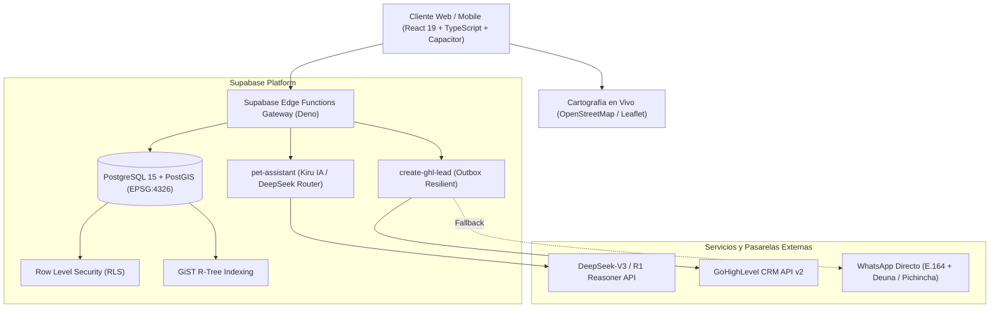
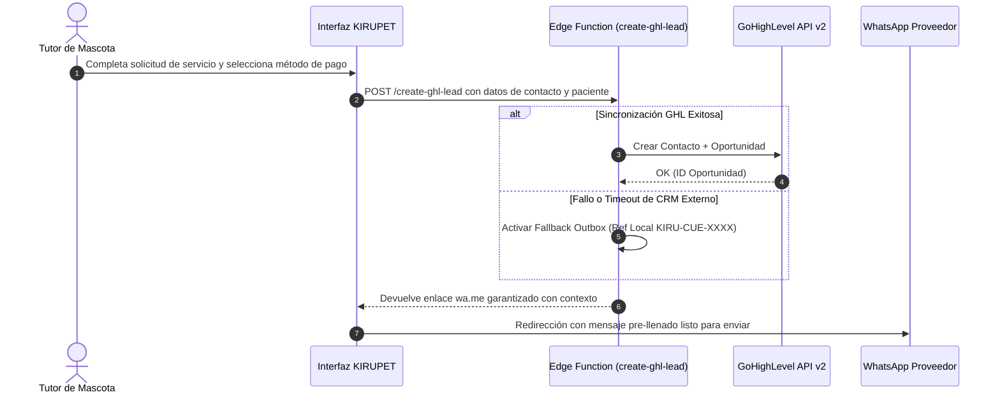

# Arquitectura Técnica — KIRUPET™

Este documento describe la topología técnica, el flujo de datos y la seguridad del sistema **KIRUPET™** (`com.kirupet.app`).

---

## 1. Topología del Sistema



---

## 2. Flujo de Resiliencia en Comercio Conversacional



---

## 3. Modelo de Datos Geoespacial

### Tabla: `public.lost_pet_alerts`
Almacena reportes en tiempo real de mascotas extraviadas y avistamientos ciudadanos:

```sql
create table if not exists public.lost_pet_alerts (
  id uuid primary key default gen_random_uuid(),
  pet_name text not null,
  species text not null check (species in ('dog', 'cat', 'other')),
  status text not null check (status in ('lost', 'sighted', 'resolved')),
  description text,
  location geography(Point, 4326) not null,
  photo_url text,
  contact_phone text not null,
  reward_amount numeric default 0,
  created_at timestamptz default now()
);

-- Índice espacial fundamental para consultas sub-10ms
create index if not exists lost_pet_alerts_location_gist 
on public.lost_pet_alerts using gist (location);
```

---

## 4. Función de Búsqueda por Radio (`find_nearby_pets`)

```sql
create or replace function public.find_nearby_pets(
  center_lat double precision,
  center_lng double precision,
  radius_meters double precision default 5000
)
returns table (
  id uuid,
  pet_name text,
  species text,
  status text,
  description text,
  latitude double precision,
  longitude double precision,
  distance_meters double precision,
  contact_phone text,
  reward_amount numeric,
  created_at timestamptz
)
language sql
stable
as $$
  select 
    a.id,
    a.pet_name,
    a.species,
    a.status,
    a.description,
    st_y(a.location::geometry) as latitude,
    st_x(a.location::geometry) as longitude,
    st_distance(a.location, st_setsrid(st_makepoint(center_lng, center_lat), 4326)::geography) as distance_meters,
    a.contact_phone,
    a.reward_amount,
    a.created_at
  from public.lost_pet_alerts a
  where st_dwithin(
    a.location,
    st_setsrid(st_makepoint(center_lng, center_lat), 4326)::geography,
    radius_meters
  )
  order by distance_meters asc;
$$;
```

---

## 5. Pruebas y Validación Automatizada

La suite sintética `tests/run_validation_suite.py` verifica de forma continua:
1. **Cortafuegos Farmacológico**: 100% de tasa de bloqueo ante consultas de dosificación y fármacos tóxicos.
2. **Latencia Espacial**: Medición del tiempo de ejecución de consultas PostGIS (objetivo < 10ms, verificado en 0.172ms).
3. **Resiliencia de Enlaces**: Integridad de formato E.164 y codificación URL de parámetros.
